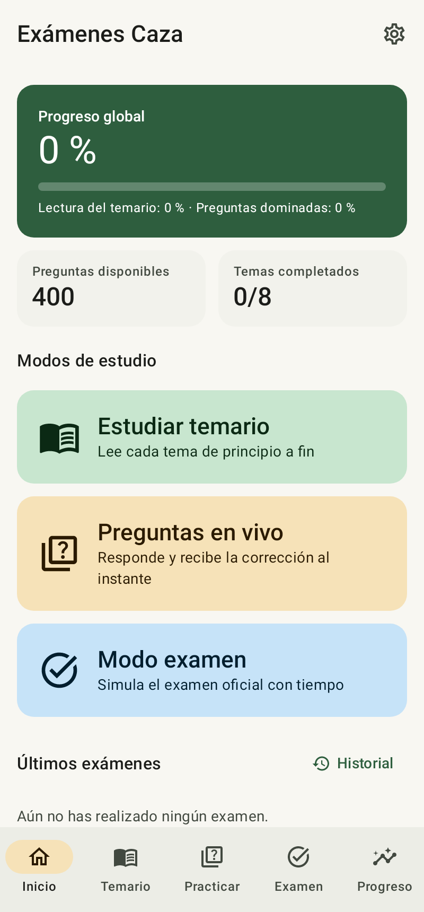
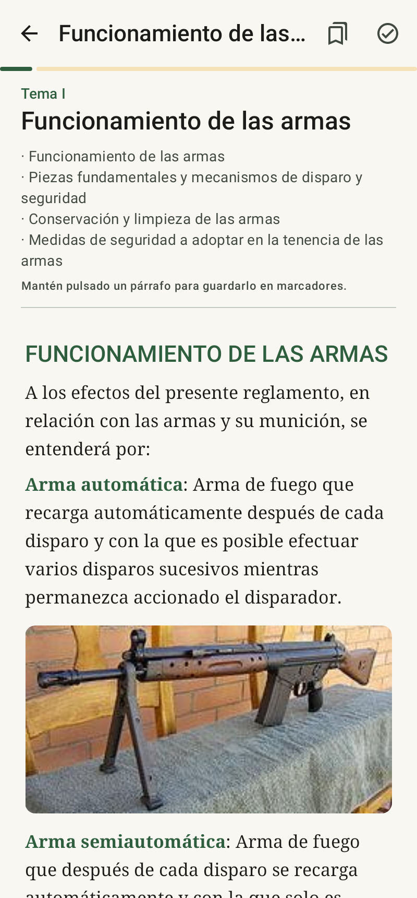
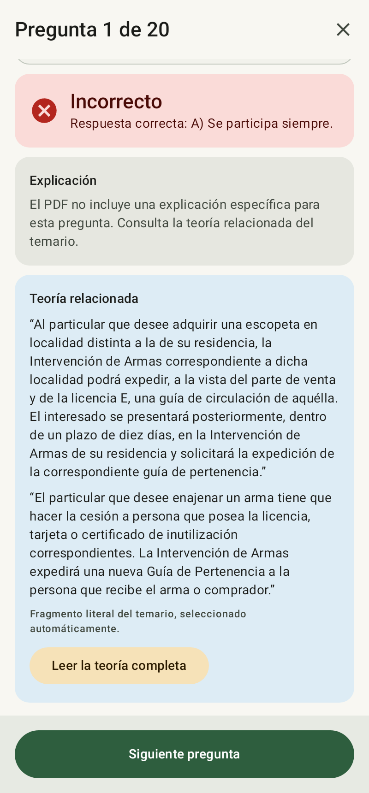
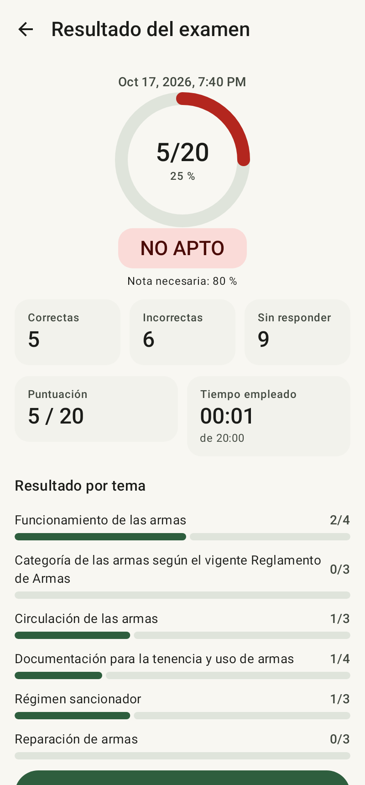
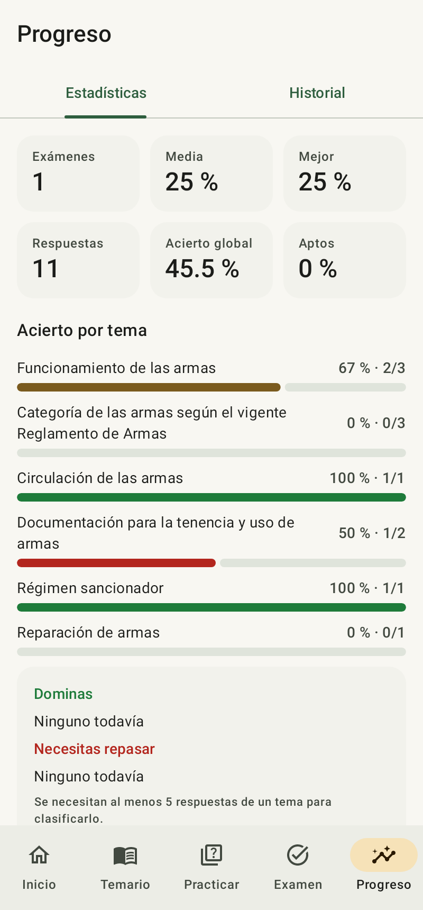

# Exámenes Caza

Aplicación Android para preparar el examen teórico de las licencias de armas D/E (y AEM). El temario
viene **incluido en la app**: el PDF de esta carpeta se empaqueta en el APK y se procesa automáticamente
la primera vez que se abre (unos segundos). No hay importación ni edición de contenido. Toda la
información (temario, preguntas, respuestas correctas) sale del PDF: la app no inventa nada.
Funciona totalmente sin conexión.

| Inicio | Lectura | Corrección inmediata | Resultado | Estadísticas |
|---|---|---|---|---|
|  |  |  |  |  |

## Funciones

- **Temario integrado**: al compilar, la tarea Gradle `bundleStudyPdf` copia el único PDF de la raíz del
  proyecto a `assets/temario.pdf` (la compilación falla si no hay exactamente uno). En el primer arranque
  se extraen temas, teoría (con negritas e imágenes), preguntas y respuestas correctas y se guardan en
  la base de datos. Solo se vuelve a procesar si una actualización de la app trae un PDF distinto, y eso
  nunca borra el historial. Para cambiar el temario: sustituye el PDF de la carpeta y recompila.
- **Estudiar temario**: lista de temas con búsqueda, progreso, subapartados y marcadores; lectura en
  scroll continuo, con posición guardada, "marcar como completado" y paso al siguiente tema.
- **Preguntas en vivo**: por temas o aleatoria general, número de preguntas, prioridad a falladas y no
  respondidas, corrección inmediata con la respuesta correcta y la teoría relacionada del temario.
  Resumen final con desglose por tema y repetición de las falladas.
- **Modo examen**: preset oficial detectado en el PDF (20 preguntas, 4/3/3/4/3/3 por tema, 20 minutos,
  apto con 16) o examen personalizado (temas, número, tiempo, penalización, nota de corte). No muestra
  respuestas hasta entregar. Resultado, comparación con exámenes anteriores y revisión con filtros.
- **Progreso**: historial persistente, media, mejor nota, tendencia, acierto por tema, temas fuertes y
  débiles, preguntas más falladas.
- **Ajustes**: tema claro/oscuro, idioma, tamaño de texto, valores por defecto, exportar historial a
  CSV/JSON y borrar progreso (con confirmación escrita).

## Cómo se interpreta el PDF

El PDF incluido en esta carpeta se analizó así (ver `app/src/main/java/.../parser/DocumentParser.kt`):

- La teoría está antes del banco de preguntas, dividida por encabezados `Tema N:`; el índice inicial
  (`Tema N:` seguido de `·` viñetas) da los títulos y subapartados.
- El banco de preguntas empieza en `TEMA I` y cada pregunta tiene opciones `A).-`, `B).-`, `C).-`.
- **La respuesta correcta es la opción impresa en negrita.** Se calcula la proporción de caracteres en
  negrita de cada opción (en el PDF a veces la negrita está desplazada un carácter, p. ej. `**S**í`).
  Si ninguna opción destaca claramente, o varias lo hacen, la pregunta no se usa: nunca se asigna una
  respuesta por suposición (con este PDF no ocurre en ninguna de las 400).
- El formato oficial del examen se lee del texto introductorio ("al menos a 16 de las 20 preguntas",
  "tiempo máximo … 20 minutos", "Del TEMA I: 4 preguntas"…).
- El PDF no trae explicaciones por pregunta, así que no se muestra ninguna; en su lugar aparecen
  fragmentos literales del temario relacionados (seleccionados automáticamente por coincidencia de vocabulario).

Resultado con el PDF de esta carpeta: 400 preguntas (las 400 que declara el propio PDF), 70/65/65/70/65/65
por tema, todas con respuesta identificada; 98 imágenes; un aviso en la última pregunta, cuya opción C
aparece cortada en el propio PDF ("…Intervención de Armas y Exp").

## Arquitectura

Kotlin · Jetpack Compose · Material 3 · Room · DataStore · Coroutines/Flow · MVVM.

```
app/src/main/java/com/examenescaza/app/
  parser/   Lógica pura de Kotlin: glifos → líneas con negrita → documento estructurado (testeable en JVM)
  pdf/      PdfBox-Android (texto + fuente + imágenes) del PDF integrado
  domain/   Selección de preguntas, generación de exámenes, barajado seguro de opciones, puntuación
  data/     Room (entidades, DAO), repositorios, DataStore, exportación
  ui/       Pantallas Compose y ViewModels
```

Integridad de datos:

- El historial (exámenes, prácticas, estadísticas, marcadores, lectura) no tiene claves foráneas hacia el
  temario. Cada respuesta de examen guarda una copia del enunciado, opciones mostradas, respuesta correcta
  y teoría relacionada, y las preguntas se identifican por una clave estable (hash del contenido). Por eso
  actualizar la app con un PDF distinto no borra ni corrompe el historial.
- Las prácticas y exámenes se guardan tras cada respuesta y pueden reanudarse tras cerrar la app.
- No hay `fallbackToDestructiveMigration`: los cambios de esquema necesitan migraciones explícitas
  (`AppDatabase.MIGRATIONS`); los esquemas se exportan en `app/schemas/`.
- Las opciones solo se barajan si ninguna hace referencia a otras ("Las dos anteriores", "A y B"…).
- Por defecto los fallos no restan (el PDF no lo establece); la penalización es configurable.

## Compilar e instalar

Requisitos: JDK 17 y Android SDK (plataforma 35). En este equipo:

```bash
export JAVA_HOME=$HOME/.jdks/jdk-17.0.20.1+1     # JDK descargado durante el desarrollo
./gradlew :app:assembleDebug                     # APK: app/build/outputs/apk/debug/app-debug.apk
./gradlew :app:testDebugUnitTest                 # todos los tests
adb install -r app/build/outputs/apk/debug/app-debug.apk
```

`local.properties` apunta a `sdk.dir=/home/mario/android-sdk`. También puede abrirse en Android Studio.
Para instalar sin `adb`, copia el APK al móvil y ábrelo (permite "instalar apps de origen desconocido").
Al abrir la app por primera vez verás "Preparando el temario" unos segundos; después ya está todo listo.

## Tests

`./gradlew :app:testDebugUnitTest` (JVM + Robolectric, no necesita emulador):

- `RealPdfParsingTest`: lee el PDF real de esta carpeta con PDFBox de escritorio y comprueba las 400
  preguntas, el reparto por tema, respuestas conocidas, el preset oficial y la teoría relacionada.
  Se omite si no hay PDF.
- `AndroidPdfExtractorTest`: ejecuta el extractor de la app (PdfBox-Android) sobre el mismo PDF y
  comprueba que da exactamente las mismas preguntas y respuestas, y que extrae las imágenes.
- `DocumentParserTest`: documentos sintéticos — temas, asociación pregunta-tema, negrita ambigua o
  ausente, opciones que faltan, duplicados, preset, anexos, ensamblado de líneas.
- `QuestionLogicTest`: aleatorización sin duplicados, prioridad de falladas, reparto oficial, límite
  de preguntas, barajado de opciones, puntuación y penalización, umbral 16/20.
- `RepositoryTest`: entrega y puntuación de exámenes, persistencia tras reiniciar, respuestas
  congeladas tras entregar, reimportación sin pérdida de historial, reanudación de sesiones,
  estadísticas por tema, borrado de progreso.
- `BundledContentTest`: el PDF integrado se procesa en el primer arranque (400 preguntas, formato
  oficial) y no se reprocesa ni toca el historial en arranques posteriores.
- `MigrationTest`: validación del esquema exportado de Room.
- `AppFlowTest`: interfaz Compose real recorriendo los tres modos (estudio, práctica, examen y revisión).

Los tests usan el mismo PDF integrado; los datos sintéticos de prueba (`TestContent`) solo existen en
el código de test y no se incluyen en la app.
